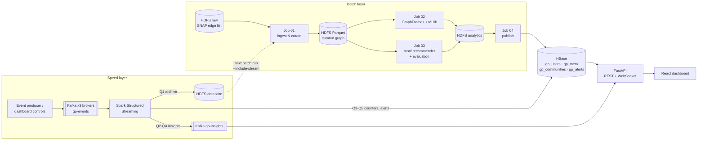

# GraphPulse: Real-Time Social Network Intelligence

> CSBB 422 Big Data Analytics, Lab Project (Topic 15: Social Network Analysis)

GraphPulse is a distributed platform for analysing a large social graph. It runs on a 3-machine cluster and covers four things:

- **Influence.** PageRank, plus a composite influence index.
- **Structure.** Community detection with quality metrics: modularity, conductance and density.
- **Recommendations.** A "People You May Know" recommender built on motif finding, with offline evaluation.
- **Fake-account detection.** In batch (MLlib) and in real time (Spark Streaming).

All of it is served in milliseconds from HBase to an interactive dashboard.

It uses a **Lambda architecture**:



## Features

| Area | What it does | How |
|---|---|---|
| **Influence ranking** | PageRank + influence index (0–100), global ranks | GraphFrames `pageRank`, percentile windows |
| **Community detection** | Communities with size, density, **conductance**, avg clustering, PageRank mass; global **modularity Q**; community-to-community map | GraphFrames `labelPropagation`, distributed aggregations |
| **Network structure** | Degree distribution (power-law), triangles, local clustering coefficient, reciprocity, weakly connected components | `triangleCount`, `connectedComponents`, `inDegrees/outDegrees` |
| **Small-world analysis** | Hop distance from every user to the top-5 influencers | `shortestPaths` with landmarks |
| **People You May Know** | Top-10 recommendations per user, each explained ("because you follow …") | **Motif finding** `(a)-[]->(b); (b)-[]->(c)` + Adamic-Adar scoring |
| **Recommender evaluation** | precision@10 / recall@10 / hit-rate on 5% held-out edges vs a popularity baseline | Train/test split in Spark |
| **Fake-account detection (batch)** | Suspicion score 0–100, with human-readable reasons | MLlib `StandardScaler` + `KMeans` distance-to-centroid + rules |
| **Detector evaluation** | 250 planted bots of 5 kinds: 95–97% caught, AUC 0.997, after fixing the one blind spot the test found (follow-back farms). See [docs/BOT_DETECTION_EVAL.md](docs/BOT_DETECTION_EVAL.md) | `tools/plant_bots.py` + `jobs/eval_bot_detection.py` |
| **Real-time threat radar** | Follow-spam bursts detected within seconds, enriched with the batch suspicion score | Structured Streaming sliding windows + watermark + **stream-static join** |
| **Rising stars** | Accounts gaining followers fastest right now | 2-min sliding window, 10 s slide |
| **Live counters** | "Followers (live)" = batch value + streaming delta | Atomic **HBase counters** from `foreachBatch` |
| **Six degrees** | Shortest follow-chain between any two users, on demand | Bidirectional BFS over adjacency lists in HBase |
| **Cluster monitor** | Live status of all daemons on all 3 PCs, HDFS/YARN usage, Kafka topics, job history, scaling benchmark | NameNode JMX, YARN REST, HBase JMX, Kafka Admin API |
| **Demo control room** | Buttons that inject a *viral surge* or a *bot attack* into Kafka | API-side Kafka producer |

## Tech stack

Hadoop 3.3.6 (HDFS + YARN) · Spark 3.5.1 (SQL, GraphFrames 0.8.3, MLlib, Structured Streaming) · Kafka 3.7 (KRaft, 3 brokers) · HBase 2.5.8 (+ Thrift) · Python 3 · FastAPI · React 18 + react-force-graph + Recharts.

**Cluster:** `master` (NameNode, ResourceManager, HMaster, ZooKeeper, Kafka controller) + `worker1`, `worker2` (DataNode, NodeManager, RegionServer, Kafka broker).

## Repository layout

```
cluster/
  config/          Hadoop, Spark, HBase, Kafka configs for the 3-node cluster
  scripts/         install_node.sh, setup_ssh.sh, bootstrap.sh, start_all.sh, stop_all.sh, status.sh
  hbase/           HBase table definitions (pre-split)
jobs/
  job01_ingest.py              raw edges -> curated Parquet (+ merges streamed events)
  job02_graph_analytics.py     PageRank, CC, LPA, triangles, shortest paths, KMeans anomalies, modularity
  job03_recommendations.py     motif-based Adamic-Adar recommender + offline evaluation
  job04_publish_serving.py     distributed writes to HBase (+ optional JSON snapshot)
  stream_graph_events.py       5 Structured Streaming queries (lake, throughput, rising, threats, counters)
  eval_bot_detection.py        scores the suspicion score against planted bots (docs/BOT_DETECTION_EVAL.md)
producer/          Kafka event generator (baseline / viral / bot scenarios)
api/               FastAPI service (HBase + Kafka, falls back to snapshot/simulation)
ui/                React dashboard
scripts/           download_data, run_pipeline, run_stream, run_api, benchmark_scaling
tools/             make_demo_snapshot.py: synthetic offline dataset for development
                   plant_bots.py: hides labelled fake bots in a real graph, to test the detector
demo-snapshot/     pre-built synthetic snapshot (offline demo / UI development)
docs/              CLUSTER_SETUP.md, CLOUD_SETUP.md, COMMANDS.md, DEMO_SCRIPT.md, BOT_DETECTION_EVAL.md
```

## Quick start

### A. Offline on any laptop (no cluster, ~2 minutes)
The dashboard runs on a bundled **synthetic** snapshot, and an in-process engine imitates the stream. This is useful for UI work and as a backup. The UI labels this mode "Snapshot (offline)" and "Simulated stream".
```bash
cd api && pip install fastapi "uvicorn[standard]" requests kafka-python
GP_BACKEND=snapshot GP_LIVE=simulate uvicorn app.main:app --port 8000
cd ui && npm install && npm run dev        # http://localhost:5173
```

### B. On the cluster
Full guide: **[docs/CLUSTER_SETUP.md](docs/CLUSTER_SETUP.md)**.
```bash
./cluster/scripts/install_node.sh master|worker1|worker2   # each PC
./cluster/scripts/setup_ssh.sh && ./cluster/scripts/bootstrap.sh   # master, once
./scripts/download_data.sh                                  # SNAP Twitter -> HDFS
./scripts/run_pipeline.sh                                   # batch layer on YARN
./scripts/run_stream.sh                                     # speed layer
python3 producer/event_producer.py --edges data/twitter_combined.txt --rate 40
./scripts/run_api.sh                                        # http://master:8000
```

## HBase schema

| Table | Row key | Column families |
|---|---|---|
| `gp_users` | user id (pre-split `2,4,6,8`) | `m:` metrics (pagerank, influence, community, clustering, suspicion, …) · `n:` adjacency (`out`, `in`) · `r:` recommendations · `s:` streaming counters |
| `gp_communities` | community id | `c:json` |
| `gp_meta` | document name (`summary`, `leaderboard`, `viz_top`, `run:<ts>:<job>`, …) | `d:json` |
| `gp_alerts` | `(9999999999 - window_start):user` (newest first) | `a:json`, TTL 7 days |

## Streaming queries

| Query | Logic | Sink |
|---|---|---|
| Q1 lake | raw events, partitioned by date | HDFS Parquet (feeds the next batch run) |
| Q2 throughput | 5 s tumbling window × event type, 20 s watermark | Kafka `gp-insights` |
| Q3 rising stars | follows per target, 2 min window sliding 10 s | Kafka + HBase `gp_meta:live_rising` |
| Q4 threat radar | follows per source, 30 s window sliding 10 s, ≥ 25 → alert; joined with the batch user profile | Kafka + HBase `gp_alerts` |
| Q5 live counters | follow/unfollow deltas aggregated per micro-batch | HBase atomic counters `gp_users:s:*` |

## Dataset

[SNAP ego-Twitter](https://snap.stanford.edu/data/ego-Twitter.html): 81,306 users, 1,768,149 directed follow edges (anonymised ids). The dashboard shows generated aliases (e.g. `@swiftotter42`) derived from ids, purely for readability.

## Team

| Name | Roll no. | Responsibility |
|---|---|---|
| | | |

The one and only, lord Amyzz
